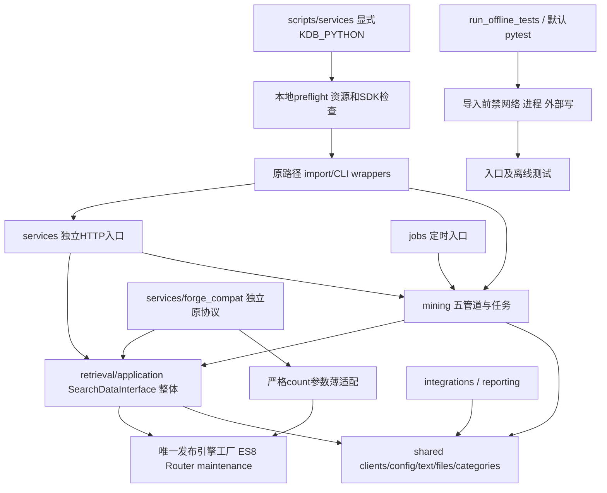

# 已实施候选架构（2026-11-06复核）

候选 `/root/kdb-forge-refactor-dev-20261105-restart`；尚未切换运行服务。来源为发布f6a78084和四个SHA核验dirty挖掘修复，逐文件见本轮assembly.json。

正式服务位于services/retrieval、off_task、crawler、files、multilingual、csat、fastgpt_proxy；旧12业务POST协议原样搬入retrieval/app.py，不与独立forge协议合并。五controller留原subprocess、解释器、shell、cwd、env、信号/超时机制。

客户类目推断及缓存保持在SearchDataInterface，不从类中抽走。shared中的通用客户端、文件和纯文本模块按已有独立模块搬移。旧import路径委托同一正式模块；__file__计算使用本候选中的原逻辑路径；Flask资源根保留原目录语义。

forge原重复核心位于archive/forge_pre_refactor，正式import不使用archive。原Repository保持完整纯委托文件；KnowledgeService构造、更新、配置工厂与计数公开协议承接至薄适配。严格count只补forge原SDK参数并复用发布完整性校验；已发布ES8/Router原文件字节不变。

config旧名使用受忽略本地链接，私有有效值在private/runtime_config；Prompt位于resources并保留旧名链接。运行data/output/log、migration_runs不搬，不自动执行手工queue/drain/迁移工具。

图中业务箭头表示最终委托关系，不能理解为已经完成全部import重写：253条正式模块仍经旧命名空间薄wrapper进入canonical模块，是过渡混合依赖图；残留路径与目标目录偏差见docs/runbooks/refactor_residuals_20261106.md。

服务launcher新增本地预检，显式解释器、SDK版本和资源检查通过后才exec原wrapper；--check不启动业务。实际原__main__/worker lifespan接线已在禁外部操作、替换外部边界的测试中检查；五项本地预检通过，语言模型/fasttext与CSAT真实认证缺失仍明确失败。配置指针仅在候选私有副本重绑。

检索另有真实ES同PIT视图验证：30重点样本、两轮60对原SDK计划与响应相同，不包含真实知识生成；五挖掘任务的完整生命周期、全部LLM/SQL/MinIO行为及生产切换仍未验收。默认测试入口只收集受保护的entry_smoke/offline，历史套件显式选择；具体边界见docs/runbooks/offline_testing.md。
