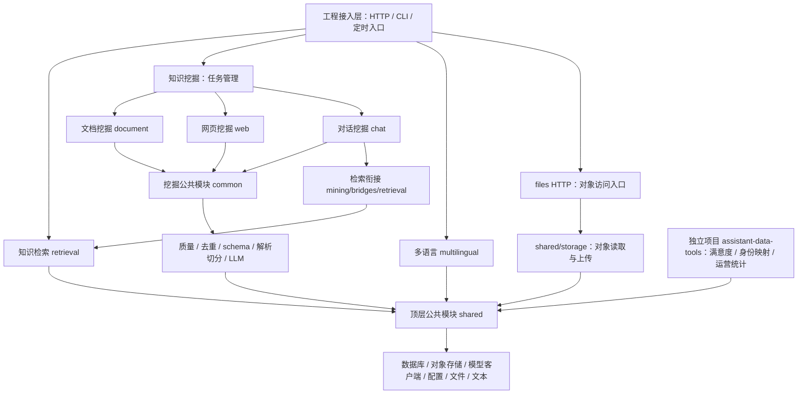

# 业务架构与依赖方向

主体分为知识检索、知识挖掘、多语言、公共模块。工程入口负责参数、HTTP 响应和生命周期，业务模块不得反向导入入口。下图箭头表示调用或依赖方向。

任务管理通过子进程启动管道 CLI，图中任务到管道的箭头包括运行时调用，不全是 Python import。`scripts/testing/architecture.py` 校验实际静态 import 方向和环；动态命令的入口另有离线断言。

当前检索桥只有对话域的未回复问题复盘调用：用问题改写检索现有知识，再判断知识覆盖情况。document/web 当前没有调用该桥，图中不画这些依赖。files HTTP 属于工程入口，shared/storage 属于公共能力。

| 目录 | 职责与边界 |
|---|---|
| `retrieval/application/` | 唯一 SearchDataInterface 门面、服务运行对象与业务查询 |
| `retrieval/search/`、`ranking.py`、`statistics.py` | 查询、多查询、分页、分数整理与计数聚合 |
| `retrieval/ingestion/`、`categories/`、`file_operations.py` | 数据准备、ID、入库去重、写入、类目与按文件操作 |
| `retrieval/engines/` | ES8.17、索引路由、协议与初始化；engines/providers 保留原实现，工厂仍只允许 ES8.17 |
| `retrieval/maintenance/` | 审核、导出、迁移、修复与清理 |
| `mining/tasks/` | 唯一队列状态、资源计数、SQL 记录、子进程、提交、估算与任务报表 |
| `mining/document/`、`web/`、`chat/` | 各来源专属管道、阶段、数据读取与处理 |
| `mining/common/` | 共用 llm、quality、deduplication、schema、parsing、segmentation、generation 等 |
| `mining/bridges/retrieval.py` | 挖掘跨域访问检索的唯一模块；公共质检不依赖该桥或聊天抽取器 |
| `multilingual/` | 模型加载、规则优先识别、标签转换与唯一模型状态 |
| `shared/` | 通用存储、SQL、客户端、相似度、类目树、配置和文本文件处理，不导入业务域 |
| `entrypoints/http/` | 四服务：retrieval、tasks、files、multilingual，保留原协议 |
| `entrypoints/cli/`、`entrypoints/scheduled/` | 参数解析、命令注册、日志接线，业务函数在所属域 |
| `operations/data_migration/` | SQL 迁移；ES 迁移属于 retrieval/maintenance |

## 公共能力的调用方向

聊天抽取和通用质检共用的 Prompt 加载、模型客户端及输出清理在 `mining/common/llm/`。两者均可调用这些公共函数，公共函数不导入抽取器或质检流程。聊天专用 Prompt 选择仍在 `chat/generation/`。

shared 只依赖自身和基础库；mining/common 不依赖 chat/document/web/tasks/bridges 的专项实现；retrieval 不依赖 mining 或入口。挖掘访问检索必须经过桥接模块。核心不导入 assistant_data_tools；独立项目只可导入 kdb.shared。默认离线测试检查这些约束。

## 状态与重复实现

检索方法按职责拆分后仍绑定到同一个 SearchDataInterface 实例。五条管道保留各自控制器和调度规则，阶段函数继续使用原实例。队列、锁、停止标志和资源计数只由 mining/tasks/state.py 持有，详见[状态所有权](state_ownership.md)。

完全相同的两份文档切分实现、两份深度爬取实现分别合并为一份。函数只有依赖和语义也一致时才合并：页面输出共用文件 I/O，但文档格式化保留图片地址，审阅格式化仅保留文本，两种 formatter 分开。

本地数据集 ID 为 `retrieval/ingestion/raw_records.py::gen_local_dataset_record_id`；知识入库 ID 为 `retrieval/ingestion/identifiers.py::gen_data_id`。两者算法和用途不同，不能合并。正式批量入库仍关闭本地读取器的可选 ID 生成。

## 独立辅助项目

assistant-data-tools 管理满意度、身份映射、独立运营报表和工作流评测，使用自己的配置与产物目录，固定配对 assistant-data-tools 0.1.0 / kdb 0.2.0。四个核心服务与辅助项目的 CSAT 是独立部署单元；CSAT 的 URL、签名和返回保持原样。项目拆分不自动迁移系统 cron、私有配置或线上进程。
