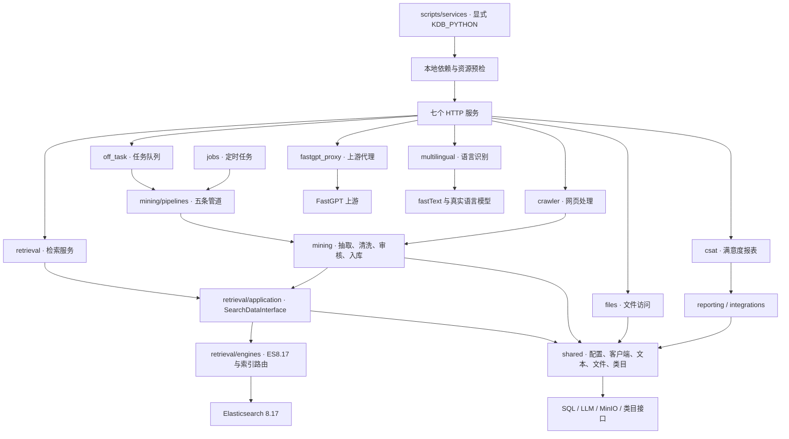

# 项目架构

`src/kdb` 是业务代码的唯一入口。七个 HTTP 服务、五条挖掘管道和定时任务直接引用包内模块；启动器使用 `python -m kdb.…`。

| 目录 | 职责 |
|---|---|
| `services/` | HTTP 参数、响应、服务生命周期；对外沿用原业务协议 |
| `retrieval/application/` | 检索、文档处理及通用业务兼容行为；SearchDataInterface 是唯一业务实现 |
| `retrieval/engines/` | Elasticsearch 8.17 请求、索引路由、计数与维护接口 |
| `mining/` | 五条管道及可组合的抽取、清洗、质量审核、任务阶段 |
| `jobs/` | 定时批次入口与调度所需逻辑 |
| `shared/` | 配置路径、外部客户端、类目、文件、文本等共用模块 |
| `integrations/`、`reporting/` | 外部系统适配与统计报表 |
| `resources/` | Prompt 等随代码发布的静态资源 |
| `function_schema/` | 当前函数输入输出、SQL 字段及来源契约 |
| `scripts/`、`tests/` | 运维入口与离线验证 |

包内依赖使用 `kdb.*`，不依赖仓库根下的旧业务包。共享路径由 `kdb.shared.config.paths` 解析；静态资源从 `resources/` 读取，运行配置、日志、任务产物与缓存独立管理。

五条管道按各自控制器执行生成、质量处理、格式转换和入库阶段，使用任务目录中的文件交接。具体开关和失败处理依各管道实现；直接检索/入库 API 保留各自默认参数与索引选择行为，详见对应函数契约。

对外服务只保留原业务接口。检索服务使用 `/search`、`/insert`、`/modify_knowledge*` 等既有路径；七个服务的参数、返回结构、默认值和原有认证行为保持一致。

服务启动预检仅验证本地依赖、配置格式与资源存在。语言服务仍缺真实 fastText 依赖/模型，CSAT 仍缺真实认证配置；离线测试通过不能证明这些资源已就绪，也不代表真实后端或生产运行已经验收。
