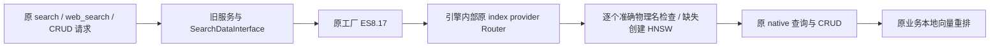

# 旧 8003 缺失索引自动创建与联合检索修复

2026-10-05。用户要求“总之解决，然后解决完叫wholeagent继续测试”。本轮处理 wholeagent 发现的缺失私库使公共库联合检索失败；已在本机旧目录加载并完成下面列出的验收。wholeagent 后续已回放五题完整 workflow，空答阻断消失；部分 segment 与 QA 的新旧召回仍有差异，见文末补充，不将本次通过扩大为整个 ES8 兼容或质量等价验收。

运行目录 `/root/knowledge_database_builder`；隔离开发目录 `/root/knowledge_database_builder-es8-autocreate-fix`，detached HEAD。两者源码提交基线均为 `a36efc7245dedf2492f5be396f87390885f3a4f4`，加未提交补丁。另一个既有审计目录 `/root/knowledge_database_builder-es8-dev` 的整套引擎修复没有整体覆盖到运行目录。

## 原因与处理结果

用户对旧行为的记忆正确：旧 ES7 `_get_index_name` 会逐索引 `_ensure_index`，不存在的索引先按完整 mapping 创建，再继续查询。因此空私库不贡献结果，公库仍能返回知识。`auto_update_mapping=False` 不禁止新建缺失索引。

运行 ES8 配置关闭了 `ensure_index_on_init`；引擎还仅绑定每组首索引，并在 search 子请求失败时放弃整个联合查询。最终 8003 三次尝试后返回 HTTP200 的“检索结果错误”哨兵，使 workflow 空答。这些原因已经分别核对旧源码、当前配置和真实请求，不能只靠跳过 404 代替自动建库。

wholeagent 后续用旧机原 ES7 client 只读反馈：`mercado_sg_retrieval_test`、`payoneer_sg_retrieval_test`、`payoneer_olive_sg_retrieval_test`、`mercado_local_sg_retrieval_test` 旧端均已存在、docs=0，creation_date 分别为 2026-10-04 UTC 03:27:13、03:26:42、03:27:32、03:27:43，早于10月5日回放。疑似10月4日早期测试通过旧自动创建路径建立，但不能仅凭创建时间最终归因某次请求。此前“缺失私库”指 SG 被核对时真实不存在，不应再描述成旧端10月5日查询时也不存在。wholeagent 未删除或写这些旧库；本会话没有重复执行旧端测试。

| 项目 | 状态与证据 |
| --- | --- |
| 每个准确物理索引名的自动创建 | 已恢复；PaaS/Serverless 真实完整 native HNSW mapping，原索引名未转换 |
| 每组只检查首索引 | 已修；`es8_search_interface.py:154` 逐索引绑定，保持输入 A/B/C 次序 |
| 失败的 mapping 检查被缓存 | 已修；`:128` 成功后缓存，失败再次调用仍校验 |
| 多 worker 同时建空库 | 已修，离线行为回归；`:266` 只接受 `resource_already_exists_exception`，随后严格检查胜出 mapping；未进行真实并发压力实验 |
| 已缓存索引被删除后未重建 | 已修，离线回归；重新检查存在性，清除缓存后按原名称创建 |
| 单索引在线查询异常丢公库结果 | 已修；`:886` 保留其它成功索引/子路，并记录异常；mapping/建库守卫不统一吞错 |
| QA/segment、私库在前/后、search/web | 隔离双集群与运行 8003 均通过以下限量真实检查 |
| 原请求与业务重排 | 请求模型、业务层、工厂、Router 未因本问题修改；未改原评分公式、向量字段返回或 CRUD 方法 |

本机使用独立配置 `config/config_es_engine_es817.old.local.json`（0600），从原共享 runtime 复制，仅将 `ensure_index_on_init` 设为 true；`auto_update_mapping` 仍为 false。`config_for_search_index_es817.local.json` 仅改 `search_engine_config_path` 为该旧目录独立文件。现有 hosts、credentials、providers、index_routes、维度、版本和物理名称保持一致；不再为旧服务的这个开关修改 `/root/kdb-forge` 的共享文件。共享 runtime 前后 SHA256 均为 `53342680f8135720aa4b8e0ab89baa4e630f6efd2304882d6c53745324dd6a4e`。

只重启本机 `knowledge-database-search.service` 一次，时间 2026-10-05 20:46:59 CST，PID `3178826 → 3214210`。WorkingDirectory 仍为旧项目，OpenAPI HTTP200。使用现有 ES8.17 venv，未替换依赖。没有 commit、push、远端部署、其它服务重启、别名/路由切换或新项目修改。



## 实际验收

| 验证 | 本轮结果 | 边界 |
| --- | --- | --- |
| 相关离线回归 | 130 passed，0 failed，135 既有 warnings，2.72s | 32 项新自动建库用例 + 12 项此前 metadata 用例 + 86 项既有用例；真实业务/工厂/引擎，模拟外部 ES/embedding 边界 |
| 同一批新用例对发布 caed 引擎的反例 | 首 30 项为 17 failed / 13 passed | 显式预加载实际发布引擎，再加载测试，避免 conftest/PYTHONPATH 误测修复版本 |
| 隔离真实 native ES + 旧 ASGI/业务/工厂 | Serverless 12/12，PaaS 12/12 | 原始请求；完整 root/nested source 回读；QA/segment、双顺序、空库；query embedding 在此阶段为匹配的合成向量边界 |
| 实际运行 8003 联合检索 | 12/12 | Serverless 准确合成 A/B；真实服务 embedding，同一模型生成 fixture，QA 重排约 1.2、segment 约 1；双顺序、空库均正常 |
| 实际运行 8003 原 CRUD 请求 | 28/28 | QA/segment 插入、metadata 回读、查询、正文局部更新、metadata 合并不损正文/向量、删除及重复删除；原真实 embedding/native ES |
| 最终核对 | passed | unit/PID/OpenAPI、配置仅上述两处差异、两 provider × A/B 四次 GET 均404 |

上述是不同层次的检查数量，不据此加总为同等独立业务案例。PaaS 本轮的真实验收为隔离进程内旧 ASGI，不称为运行 8003 的完整 PaaS 写验收。运行 CRUD 工具从既有 dev 目录复用，其辅助 factory 仅定义合成 mapping；真正 HTTP 接收者是运行旧 8003，证据分别记录辅助引擎与运行引擎哈希。

仅使用此前已授权的合成作用域：`codex_source_probe_20261004_63a68e52aebb_a`、`..._b`，文档 `source-probe`，owner `63a68e52aebb`，routing None。生命周期顺序执行，先不存在性检查，后 UUID、alias、owner/文档检查，清理后验证404。没有写真实业务文档、staging、既有 mapping 或 alias，没有执行用户已暂缓的脚本更新。

恢复开关后服务正常初始化自动建立此前不存在的默认 `test_case`；最终 count=0，保留作为正常空库。这是恢复旧自动创建契约的实际副作用，不能把本轮说成“除 fixture 外没有创建任何索引”。以后 `/search` 请求未知索引也可能建空库，测试前应记录索引存在性，不能仅凭接口名声称完全只读。

## 测试工具的两处纠正

1. 初次 Serverless 验收在提取 UUID 时失败：该部署 GET index 元数据不提供 UUID，已有工具应从 `_stats/docs` 获取。已经复用同一 fallback。对已经确认创建的空合成 A 核对 owner/UUID/alias 后清理404，保留 recovery 证据。这不是业务向量存储失败，不能误归因。
2. 第一轮运行 HTTP 联合测试为 10/12：合成 unit vector 与真实模型生成的查询向量余弦为 `-0.0025418541062588638`。原业务 segment 评分是 `max(title_similarity, content_similarity)`，无 title 时 title=0，因此该 fixture 合理返回0，但工具错误要求非零。改用同一模型/同一 TITLE 的合法向量作为 fixture，分开记录 ID/metadata 与评分断言，12/12。未改业务逻辑使测试通过。初次失败 JSON 保留。

此前有一次“corrected_baseline”因 conftest 路径加载修复代码而全过，不能当发布基线证据；正确基线文件为下列 `autocreate_verified_published_baseline.xml`。早期 fixture 的 web ID 字段期望也已按旧真实输出 `_id` 校正，不能把工具错误计为引擎缺陷。

## 命令与源码

```bash
cd /root/knowledge_database_builder-es8-autocreate-fix
env PYTHONDONTWRITEBYTECODE=1 \
  PYTHONPATH=/root/knowledge_database_builder-es8-autocreate-fix:/root/knowledge_database_builder-es8-autocreate-fix/tests \
  /root/kdb-forge/.venv-es817/bin/python -m pytest -q \
  tests/test_es8_autocreate_20261005.py tests/test_es8_interface.py \
  tests/test_insert_ext_info_20261005.py tests/test_dual_route_recall.py \
  tests/test_search_response_ids.py tests/test_es_mapping_compare.py \
  tests/test_delete_by_file.py tests/test_insert_check_duplicate_arg.py \
  -p no:cacheprovider --tb=line \
  --junitxml=docs/reviews/autocreate_final_regressions_20261005.xml

env PYTHONDONTWRITEBYTECODE=1 \
  PYTHONPATH=/root/knowledge_database_builder-es8-autocreate-fix \
  /root/kdb-forge/.venv-es817/bin/python tests/es8_autocreate_live_20261005.py \
  --execute --phase isolated \
  --output docs/reviews/autocreate_live_isolated_final_20261005.json

cd /root/knowledge_database_builder
env PYTHONDONTWRITEBYTECODE=1 PYTHONPATH=/root/knowledge_database_builder \
  /root/kdb-forge/.venv-es817/bin/python tests/es8_autocreate_live_20261005.py \
  --execute --phase running \
  --output docs/reviews/es817_auto_create_fix_20261005/live_running_joint_matched_vector.json

env -C /root/knowledge_database_builder-es8-dev PYTHONDONTWRITEBYTECODE=1 \
  PYTHONPATH=/root/knowledge_database_builder-es8-dev:/root/knowledge_database_builder-es8-dev/tests \
  /root/kdb-forge/.venv-es817/bin/python tests/es8_crud_acceptance_20261005.py \
  --execute --phase running_old_HTTP \
  --output /root/knowledge_database_builder/docs/reviews/es817_auto_create_fix_20261005/live_running_CRUD.json
```

Evidence 文件禁止覆盖。复跑须换 output 名称，先检查同一合成 fixture 是否存在，不擅清理现场。最终只修改验证工具的 fixture 和分项断言，最后未重跑全部130：引擎/业务实现和离线回归测试没有发生后续修改，不重复计数。

| 文件 | 当前 SHA256 |
| --- | --- |
| engine | `113728335ebede4733b0d445f030c9117b2ac224cf7c1be92bbebe6bbafba502` |
| 服务（此前 ext_info 补丁，本轮未改） | `c4f81d69c59159b57072bf10253e2055232cb74224ea4d905c843799511a72db` |
| 业务层（未改） | `224e12340f627a5b9e5bde0ac6c934f78f072eb7ffc804dc290ce18d944c385e` |
| 工厂（未改） | `984b512e41adec742de5335a4506cb4a81b5988ee3370db8e9be0c0106a581f0` |
| Router（未改） | `3570d825d5cdd660b23eeb8bbc53befd32b39a8def0195444a7318d64a5470ce` |
| 32项新回归文件 | `fd08b97753a5060ad6925d640e2676f9b4967744a145117ed104bd4178613b95` |
| 最终真实验证工具 | `8eb27a1ba7c90eacb4a827d204b4a6d850024eb4b5859bc27cdb99fc48428220` |

修改清单和逐文件哈希见 [manifest](es817_auto_create_fix_20261005/manifest.json)。准确引擎差分见 [engine_only.diff](es817_auto_create_fix_20261005/engine_only.diff)，只有四个引擎方法；配套四份 engine schema、新测试与验证工具 schema 同步。原服务、用户未提交修改和原数据/临时文件均保留，没有 reset/clean/stash 或误提交。

脱敏证据集中在 [验收目录](es817_auto_create_fix_20261005)：130回归 XML、17失败发布基线 XML、双集群24项结果、运行联合12项结果、运行CRUD28项结果、最终校验，以及原补丁/配置私有备份。配置备份不要上传或提交。

## 后续边界

通知既有 wholeagent 复测同一组联合检索、完整 workflow 和回答差异，保持其既有 dry_run/SCRM/转发拦截，不扩张测试写权限或部署配置。此次已恢复自动创建，workflow 的缺失测试私库请求可能产生空库副作用，需提前记录存在性与授权范围。

Wayfair segment Top10 8/10 与 Olive 相似召回、Agent 回答质量差异仍应分别核对。此前广泛审计的公开接口、复杂分页/PIT/聚合、nested 写向量及性能等不因本次通过而全部关闭；用户已暂停的 Serverless Painless/脚本更新仍未处理。缓存存在性检查增加 HEAD 开销，未做并发或吞吐压测。固定数据/固定查询质量、图片/同义问法完整链路和生产发布同步仍按原验收报告界定。本轮代码为本机未提交修复，不能称已经同步到远端 main。

交接已送至既有 wholeagent 会话 `01a101b7-87f9-74c3-8240-f6a123d2f63b`，没有新建任务。跨会话 MCP 仍指向失效41307，未重启 Codex/MCP；使用该会话原 tmux pane `%3` 按用户明确指示提交，修复生效通知在当前会话记录可见。发送与会话回显证据见 `wholeagent_handoff.json` / `wholeagent_handoff_capture.txt`；不将通知送达称为 wholeagent 的完整复测已经通过。

wholeagent 已明确回复“收到新状态，我会以当前8003的engine1137283为准重跑同组测试”，开始联合查询、五个workflow及agent请求，继续SCRM/发送拦截。复测进行中，结果未在本报告预判；收到回复的观察记录见交接JSON，随后进展回显另存wholeagent_progress_capture.txt。

用户追问准确缺失名称（2026-10-05 21:07附近）：阻断报错是mercado_sg_retrieval_test与payoneer_sg_retrieval_test，另外两个测试空库是payoneer_olive_sg_retrieval_test、mercado_local_sg_retrieval_test。四者均未进入原冻结86项清单，旧端创建时间10月4日11:26–11:27 CST晚于原物理名86项完成05:36；不能把这些测试后增空库与原迁移业务库混为一谈。本轮原生HTTP只读复查，新端四项现均存在/0文档；是wholeagent续测后状态，未由本轮查询创建。证据test_private_names_readonly.json。原“全迁移”指固定清单完成，不是两端后续任意新索引自动同步。

## wholeagent 后续端到端与实际请求形状复测

既有 wholeagent 会话已完成同组回放，报告为 [/root/sell_agents/tmp/sg_retrieval_20261004/sg_old_directory_8003_e2e_after_fix_20261005.md](/root/sell_agents/tmp/sg_retrieval_20261004/sg_old_directory_8003_e2e_after_fix_20261005.md)。本会话读取完整报告及配对 JSON 结构核对后补录；这是 wholeagent 执行的实际证据，没有在这里重复启动测试或再写 ES。

五题 workflow 均无执行错误，分支与旧端一致；Mercado/Payoneer 原联合检索错误哨兵与空答消失。Olive 两侧均为空回答并走转老师分支，转发由 dry_run 拦截。请求级 Agent 8009 的一个 Mercado 案例信息一致，仅标点不同。正式 agent/workflow 的检索地址仍指向旧端，wholeagent 未改配置、部署或重启，SCRM 测试身份计数0、无真实发送。

按 workflow 实际发出的请求条件再成对直查（不把此前另一组固定 Top10 与这组 Top5 混算）：

| 客户 | QA 共同 ID / 同位置 | segment 共同 ID / 同位置 | 状态 |
| --- | --- | --- | --- |
| Mercado | 20/20；同位20/20 | 4/5；同位4/5 | QA该样本相同，segment差异待归因 |
| Payoneer | 20/20；同位20/20 | 5/5；同位5/5 | 该配对样本ID/顺序/内容相同 |
| Olive | 19/20；同位19/20 | 两侧均0条 | QA一个独有结果待归因 |
| Wayfair | 20/20；同位20/20 | 4/5；同位3/5 | segment召回及排序差异待归因 |
| Mercado_local | 两次均20/20；同位18/20 | 第一次5/5同位5/5；第二次4/5同位2/5 | 两次请求条件不同，部分次序/召回差异待归因 |

“内容相同”仅指共同 ID 的 q/a/content/metadata 哈希一致。wholeagent 的原固定查询还记录 Wayfair segment Top10 8/10共同、7/10同位，Olive QA Top20 19/20共同、18/20同位；请求不同，不能以数字不同认定证据冲突。真实配对证据为 [/root/sell_agents/tmp/sg_retrieval_20261004/workflow_actual_retrieval_paired_after_fix_20261005.json](/root/sell_agents/tmp/sg_retrieval_20261004/workflow_actual_retrieval_paired_after_fix_20261005.json)。

Payoneer 生成回答中邮件链接有无的差异，即使配对查询内容相同，也仅可推测为生成波动：workflow回答与重新成对检索不是同一毫秒快照，未证明因果。上述召回差异也尚不能统一归为 ANN 必然差异或数据丢失，需保持相同数据/请求/向量的独立比较。当前结论是“自动创建、联合链路与这五题执行恢复正常”；“全部知识、排名、所有用户请求与旧端效果完全等价”仍未通过验收。
